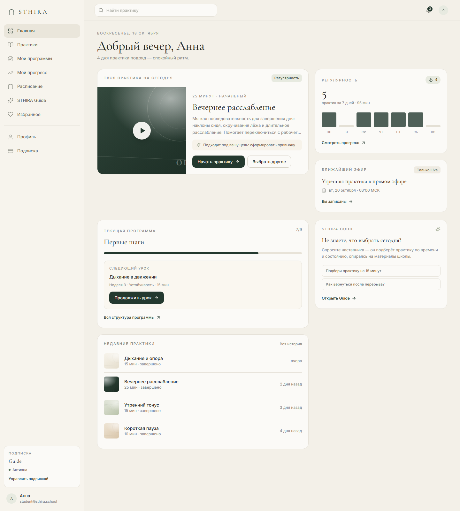
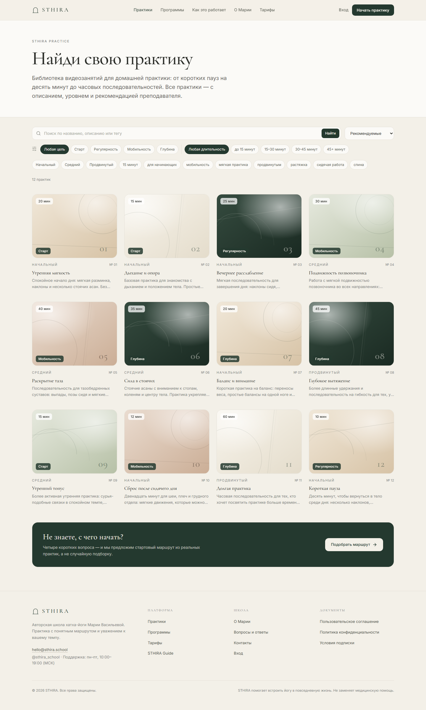
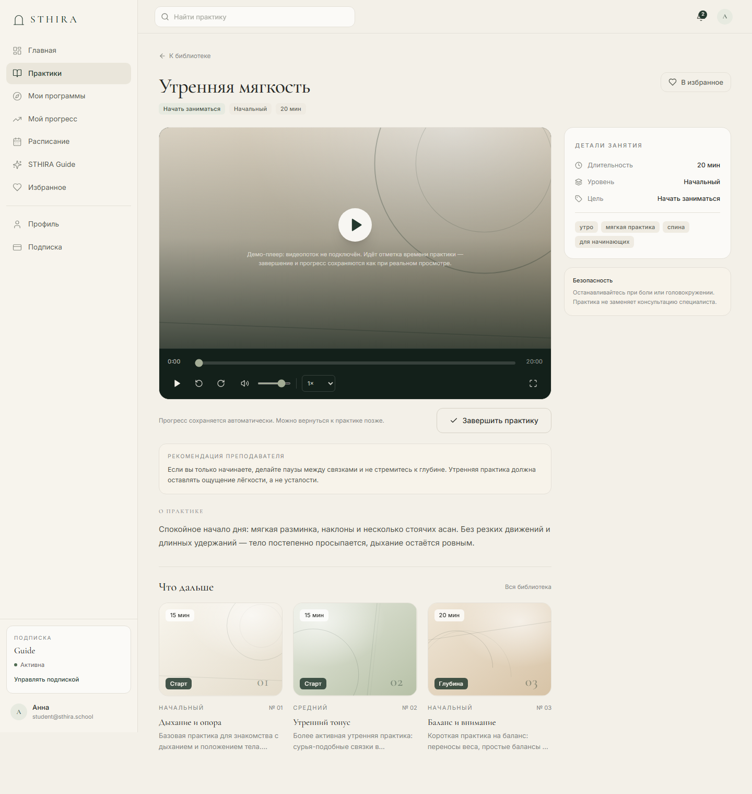
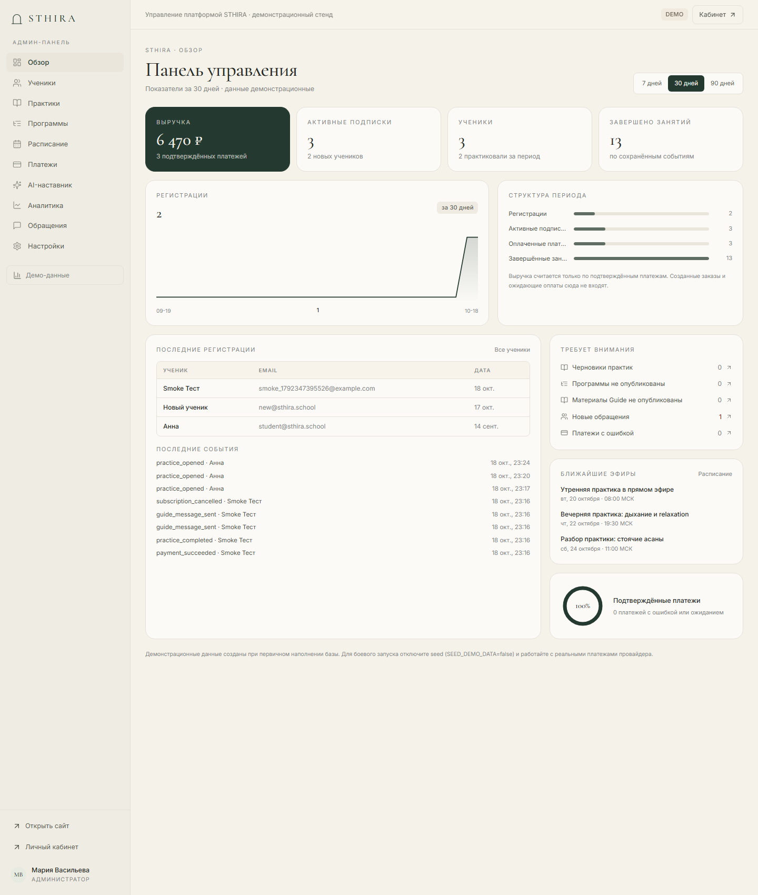

# STHIRA — онлайн-платформа хатха-йоги (MVP)

STHIRA — авторская школа хатха-йоги Марии Васильевой. Это не лендинг и не набор макетов:
публичный сайт, личный кабинет, библиотека практик, программы, прогресс, подписка с оплатой,
AI-наставник и административная панель работают на одном приложении.

**Демонстрационный стенд:** реальные платежи, письма и видеопоток заменены провайдерами-заглушками,
которые повторяют контракт production-сервисов. Всё остальное — база данных, авторизация, права доступа,
серверная бизнес-логика — настоящее.

---

## Стек

| Слой | Технология |
|---|---|
| Frontend / SSR | Next.js 15 (App Router), React 19, TypeScript, Tailwind CSS v4 |
| Шрифты | Cormorant Garamond + Inter (self-hosted через `@fontsource`) |
| Backend | Next.js Route Handlers (`/api/v1`), серверные компоненты, middleware |
| БД | SQLite (`node:sqlite`), SQL-схема + идемпотентные миграции при старте, WAL |
| Авторизация | Серверные сессии в БД, HttpOnly-cookie, scrypt-хеши, rate limit |
| Платежи | Тестовый провайдер «STHIRA Pay sandbox»: платёжная сессия → подписанный HMAC-webhook → активация |
| AI | Локальный провайдер: поиск по утверждённой базе знаний, цитаты, guardrails |
| Изображения | Сгенерированные редакционные текстуры + типографические обложки (SVG), без стоковых лиц |

## Быстрый старт

```bash
pnpm install
cp .env.example .env        # при необходимости поправьте значения
pnpm dev                    # http://localhost:3100
```

Production-сборка:

```bash
pnpm build
pnpm start                  # http://localhost:3100
```

База создаётся автоматически при первом запросе: применяется схема и, если база пустая,
добавляются демонстрационные данные. Принудительное наполнение:

```bash
pnpm seed                   # демо-данные, если база пуста
FORCE_SEED=true pnpm seed   # очистить и наполнить заново
pnpm db:reset               # удалить файл базы
```

### Демо-доступы

| Роль | Email | Пароль |
|---|---|---|
| Администратор | `admin@sthira.school` | `Admin12345!` |
| Ученик с активной подпиской Guide | `student@sthira.school` | `Student12345!` |
| Новый ученик без подписки | `new@sthira.school` | `Student12345!` |

Новый ученик проходит онбординг, не имеет подписки и видит корректные состояния блокировки.

## Скриншоты

| | |
|---|---|
|  |  |
|  |  |
|  |  |

## Что реализовано- **Публичный сайт:** главная, каталог практик с поиском/фильтрами/сортировкой, карточка практики,
  программы и структура программы, о преподавателе, тарифы со сравнением, FAQ, контакты, юридические страницы.
- **Авторизация:** регистрация, вход, выход, подтверждение email, восстановление пароля, сброс пароля,
  защита от перебора, одноразовые токены, серверные сессии.
- **Личный кабинет:** дашборд с рекомендацией, продолжение незавершённой практики, текущая программа,
  недельная регулярность, расписание, избранное, уведомления, профиль и подписка.
- **Практика:** демо-плеер с таймлайном/перемоткой/громкостью/скоростью/фулскрином, сохранение позиции,
  завершение практики, экран завершения с самочувствием.
- **Программы:** модули и уроки, текущий/следующий урок, прогресс, отсутствие дедлайнов.
- **Прогресс:** метрики из серверных событий, календарь активности за 12 недель, график по неделям, история.
- **Подписка и оплата:** три тарифа, платёжная сессия, подписанный webhook, идемпотентность,
  активация только после подтверждения, отмена автопродления с сохранением доступа, история платежей.
- **STHIRA Guide:** чат по базе знаний с цитатами и ссылками на практики/программы, лимиты, guardrails
  по медицинским вопросам, честный ответ при отсутствии материала.
- **Админ-панель:** обзор с метриками, ученики и карточка ученика, CRUD практик, редактор программ
  с модулями и уроками, платежи и webhook-события, база знаний и тест ответов, аналитика, расписание,
  обращения, тексты сайта, цены тарифов, журнал действий.

## Структура проекта

```
src/
  app/
    (site)/            публичные страницы
    (auth)/            вход, регистрация, восстановление, подтверждение
    (app)/app/         личный кабинет
    (admin)/admin/     административная панель
    (payment)/         checkout-результат и тестовая платёжная форма
    api/v1/            REST API (auth, users, practices, programs, guide, admin, webhooks)
  components/          UI-система, карточки, обложки, оболочки, формы
  content/catalog.ts   первичный контент школы (тарифы, практики, программы, база знаний)
  lib/
    db/                соединение, схема, первичное наполнение
    auth/              пароли, сессии, токены, guard
    data/              запросы и доменные преобразования
    payments/          провайдер-заглушка и сервис подписок
    guide.ts           retrieval + генерация ответов по материалам
scripts/               seed, reset, smoke-тест, визуальная проверка, генерация изображений
docs/                  API, деплой, ограничения
```

## Запуск через GitHub (Codespaces)

GitHub Pages не подойдёт: приложению нужен Node.js-сервер и SQLite. Рабочий вариант — **GitHub Codespaces**:
полноценная машина в облаке с публичным портом и стабильным адресом.

1. Создайте пустой репозиторий на GitHub и запушьте проект:

   ```bash
   git remote add origin https://github.com/<ваш-логин>/sthira.git
   git branch -M main
   git push -u origin main
   ```

2. В репозитории: **Code → Codespaces → Create codespace on main**. Конфигурация
   [.devcontainer/devcontainer.json](.devcontainer/devcontainer.json) сама выполнит `pnpm install`, `pnpm build`
   и запустит приложение на порту 3100.
3. Откройте вкладку **Ports → 3100 → Open in Browser**. В конфигурации порт помечен как `Public`;
   если он остался приватным, переключите видимость вручную.
4. Получите адрес вида `https://<имя-codespace>-3100.app.github.dev` — он не меняется при остановке
   и повторном запуске Codespace.

Демо-вход: `student@sthira.school` / `Student12345!` (данные администратора на странице входа скрыты
через `SHOW_DEMO_HINTS=student`).

Ограничения: бесплатный лимит Codespaces — 120 core-hours в месяц (2 ядра ≈ 60 часов), Codespace
останавливается после простоя (адрес сохраняется), база SQLite живёт в диске Codespace, пока он не удалён.
GitHub Actions — это CI, а не хостинг: job ограничен 6 часами и не подходит для постоянной ссылки.

CI уже настроен в [.github/workflows/ci.yml](.github/workflows/ci.yml): typecheck, сборка и smoke-тест
на каждый push и pull request.

## Поделиться ссылкой

### Вариант 1. Временная публичная ссылка (пока запущен компьютер)

```bash
pnpm start          # приложение уже должно быть собрано: pnpm build
pnpm share          # поднимет туннель и напечатает https://…
```

`scripts/share.mjs` по умолчанию поднимает SSH-туннель через `localhost.run` — он открывается без
предупреждающих страниц. Альтернативы: `node scripts/share.mjs --serveo` (serveo.net показывает
предупреждение браузера при первом переходе) и `node scripts/share.mjs --cloudflared` (если установлен
`cloudflared` или задан `CLOUDFLARED_PATH`). Ссылка живёт, пока запущены оба процесса: `next start` и
туннель. Для локальной сети сервер можно запустить на `0.0.0.0`:
`npx next start -p 3100 -H 0.0.0.0` и открыть `http://<локальный-IP>:3100`.

### Вариант 2. Постоянный адрес (Docker + свой домен)

```bash
PUBLIC_URL=https://sthira.example.com docker compose up -d --build
```

`docker-compose.yml` поднимает приложение на порту 3100 с постоянным томом `sthira-data` для SQLite.
Поставьте впереди HTTPS reverse-proxy (Caddy/Nginx/Cloudflare) и передайте реальный домен в `PUBLIC_URL`.
Порядок описан в [docs/DEPLOYMENT.md](docs/DEPLOYMENT.md).

### Перед публичной демонстрацией

- В `.env` или `docker-compose.yml` задайте `SHOW_DEMO_HINTS=student` — на странице входа останется
  только ученический демо-аккаунт, данные администратора не показываются.
- Смените пароль администратора: `pnpm set-password admin@sthira.school "НовыйПароль123"`.
- Публичная ссылка открывает сайт без авторизации — это демонстрационные данные, не загружайте реальные
  персональные данные и не используйте production-секреты провайдеров.
- Для боевого запуска: `DEMO_MODE=false`, `SEED_DEMO_DATA=false`, реальные провайдеры и HTTPS.

## Проверки

```bash
pnpm typecheck                 # TypeScript
pnpm test:smoke                # 20 сценариев критичного пути через HTTP
node scripts/visual-check.mjs  # скриншоты страниц в .tmp/shots (нужен Chrome)
```

Smoke-тест проверяет: регистрацию, запрет дублей, сессию, запрет доступа к платному контенту без подписки,
запрет админ-API без роли, создание заказа, активацию подписки только после webhook, завершение практики,
идемпотентность завершения и избранного, доступ к Guide, guardrails, отмену автопродления с сохранением
доступа, выход.

## Документация

- [API](docs/API.md)
- [Дизайн-система и карта страниц](docs/DESIGN.md)
- [Развёртывание, резервное копирование и восстановление](docs/DEPLOYMENT.md)
- [Известные ограничения MVP](docs/LIMITATIONS.md)

## Важно

Платформа не заменяет медицинскую помощь. Материалы носят информационно-образовательный характер.
Юридические тексты — шаблоны для проверки специалистом. Перед коммерческим запуском необходимо
подключить реальные платёжный, видео- и email-сервисы, согласовать персональные данные и проверить
сценарии на production-стенде.
